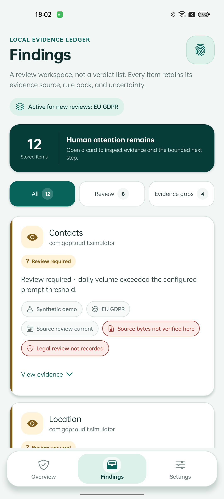
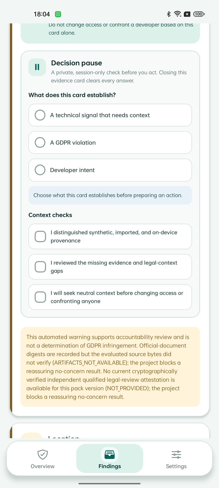

# Privacy Lens — reproducible research artifact

Privacy Lens is an offline, evidence-first Android research prototype for reviewing
permission and activity evidence. It keeps observed-device evidence distinct from
labelled synthetic demonstrations, exposes missing context instead of filling it in,
and prepares questions for proportionate human review. It does **not** decide whether
the GDPR was infringed.

This repository is the curated publication artifact derived from the final validated
implementation. It contains the implementation, the reproduction and verification
pipeline, the pinned evidence receipts, and the LaTeX source of the accompanying
thesis. Intermediate, experimental and superseded development material is
intentionally excluded; see [`docs/ARTIFACT_SCOPE.md`](docs/ARTIFACT_SCOPE.md).

Artifact version 1.15.0.

<p align="center">
  
  
  
</p>

## Research question

> How can heterogeneous Android privacy evidence be transformed into useful,
> reproducible review prompts while preventing malformed, missing, synthetic, or
> legally incomplete evidence from becoming an unsupported legal conclusion?

## Research artifact

The artifact is a working Android application plus the pipeline that verifies the
claims made about it. The pipeline is the deliverable of interest for reproducibility
review: it compiles the semantic test suites, regenerates the derived result summaries
from pinned inputs, recomputes the evidence metrics from the receipts, and enforces the
claim boundaries the thesis relies on.

| Component | Location | What it does |
|---|---|---|
| Application source | `src/`, `app/`, `components/`, `constants/` | Typed evidence admission, regulation packs, temporal evaluation, governance gates, review UI |
| Android native layer | `android/` | Kotlin capability reporting, the audit bridge, deferrable workers, host-JVM unit tests |
| Reproduction pipeline | `scripts/`, `tests/` | Semantic suites, contract checks, evidence verification, LaTeX and PDF consistency |
| Experiment configuration | `experiments/` | Mapping-review packet, baseline index, and the redacted per-sample device metrics |
| Pinned evidence | `testing-report/` | Committed receipts whose derived metrics are recomputed on every run |
| Thesis | `Thesis/Final/`, `output/pdf/` | LaTeX source and the compiled PDF |
| Documentation | `docs/` | Methodology, reproducibility, scope, limitations, traceability, development evolution |

## Key properties

- **Fail-closed admission.** Malformed identifiers, unsafe numbers, invalid windows,
  unsupported provenance and incompatible context are rejected rather than normalised
  into a reassuring finding.
- **Typed separation.** Admitted evidence, technical signal, review obligation and
  legal verdict are distinct types; the policy layer cannot emit a verdict.
- **Pinned evidence with recomputed metrics.** The census, device aggregate and
  analysis receipt are pinned by raw SHA-256; every published count is recomputed from
  them on each run.
- **Reproducible byte identity.** `* text eol=lf` in `.gitattributes` makes the
  checkout byte-identical to the committed blobs on any platform, so the pinned digests
  verify whether or not the reproducer's Git converts line endings.
- **Bounded claims.** The repository states what it does not establish. See
  [`docs/LIMITATIONS.md`](docs/LIMITATIONS.md).

## Repository structure

```text
.
├── src/                      # application logic: compliance, regulations, services, UI model
├── app/                      # Expo Router screens
├── components/               # shared React Native components
├── constants/                # shared constants and theming
├── android/                  # Android project, Kotlin native layer, host-JVM unit tests
├── scripts/                  # reproduction, verification and experiment drivers
├── tests/                    # semantic suites and contract checks
├── experiments/              # canonical experiment configuration and pinned extracts
├── testing-report/           # committed evidence receipts
├── output/                   # generated result summaries, macros and the thesis PDF
├── Thesis/Final/             # LaTeX thesis source
├── docs/                     # methodology, reproducibility, scope, limitations, traceability
└── .github/workflows/        # continuous verification
```

## Requirements

| Component | Version | Notes |
|---|---|---|
| Node.js | 20–24 | `engines` contract is `>=20 <25` |
| npm | 10.8.2 or newer | the lock file is version 3 |
| Java | 17 | required only for the Android host-JVM unit tests |
| Android SDK | platform 36, build-tools 36 | required only to build the application |
| TeX distribution | TeX Live 2026 or equivalent | optional; required only to re-render the thesis PDF |

Only Node.js and npm are needed to reproduce the core results. Nothing in the core
pipeline requires a device, an emulator, network access, the Android SDK, or a TeX
installation.

## Quick start

```bash
git clone https://github.com/zhiheng-zhang-Mera/privacy-lens-research-artifact.git
cd privacy-lens-research-artifact
npm ci
npm run reproduce:thesis-core
```

The application itself runs with:

```bash
npm start          # Expo development server
npm run android    # build and install on a connected device
```

## Reproduce the core results

```bash
npm run reproduce:thesis-core
```

This is the single canonical entry point. It runs the semantic suites and the temporal
stress campaign; checks the accessibility-source, release-privacy, experiment,
TypeScript, lint and delivery contracts; verifies the nine formal safety properties and
the mapping-review packet; regenerates the corpus, device and FlowDroid summaries and
the LaTeX result macros from the pinned receipts; verifies the evidence manifest, the
thesis numbers, the claim boundaries and the cited repository paths; and checks the
TeX sources and the PDF prose against the corrected source.

A successful run ends with summaries that include:

```text
Thesis results verified: F-Droid N=495, device N=233, PSS N=98.
Thesis evidence verified: 12 receipt-derived metrics, 4 pinned sources, release 1.15.0.
Thesis numeric consistency verified: 24 generated macros, 9 formal properties, ...
Claim-evidence path traceability verified: ...
```

It must also leave the tracked generated files unchanged. Confirm that with:

```bash
git status --short
```

Heavier checks that the thesis cites but that are kept out of the core entry point:

```bash
npm run reproduce:thesis-stress   # fixed-seed campaign twice; requires both runs to agree
npm run verify:mutation           # applies each registered weakening and requires detection
npm run test:android-unit         # Kotlin host-JVM unit tests; needs Java 17 and the Android SDK
```

## Verify the results

```bash
npm run verify
```

`verify` is the superset of `reproduce:thesis-core` that additionally executes the
mutation harness. The individual gates are also runnable on their own:

| Command | Checks |
|---|---|
| `npm run verify:line-endings` | checkout bytes are LF and the pinned evidence matches its recorded digests |
| `npm run test:compliance` | admission, threshold, temporal, governance and information-flow semantics |
| `npm run test:stress-campaign` | the temporal contract at scale |
| `npm run test:accessibility` | accessibility source contracts |
| `npm run test:release-privacy` | release-privacy and controlled-fixture contracts |
| `npm run verify:thesis-evidence` | every published metric recomputed from the pinned receipts |
| `npm run test:thesis-numbers` | generated macros, formal properties and cross-references |
| `npm run verify:claim-boundaries` | no production legal-verdict tokens and every high-risk claim qualified |
| `npm run verify:claim-paths` | every repository path cited by the thesis and the claim matrix exists |
| `npm run verify:latex` | TeX labels, references, citations, bibliography keys and stale markers |
| `npm run verify:pdf` | the compiled PDF still carries the corrected prose and no retracted fragment |

## Expected outputs

| Output | Produced by |
|---|---|
| `output/thesis-results/*.json` | `scripts/summarize-thesis-results.js` from the pinned receipts |
| `Thesis/Final/generated-results.tex` | `scripts/verify-thesis-evidence.js --write` from the evidence manifest |
| `output/thesis-results/generated-results.tex` | the same macros, for the results chapter |
| `release/SUBMISSION_MANIFEST.json` | `scripts/write-submission-manifest.js` |
| `artifacts/reproduction/`, `artifacts/mutation/` | the heavy checks; ignored by Git |

Byte-identical outputs are expected for the JSON summaries and the generated macros.
The PDF is reproducible when the render timestamp is pinned, which
`npm run reproduce:thesis-pdf` does with `SOURCE_DATE_EPOCH`; see
[`docs/REPRODUCIBILITY.md`](docs/REPRODUCIBILITY.md) for the fields that may still
differ between platforms.

## Methodology

The design, the evidence model and the verification protocol are documented in
[`docs/METHODOLOGY.md`](docs/METHODOLOGY.md). The short version: the implementation
keeps evidence admission, technical signal, review obligation and legal verdict in
separate typed layers; every published number is derived from a committed receipt; and
every claim is either backed by an executable check or recorded as a limitation in
[`docs/LIMITATIONS.md`](docs/LIMITATIONS.md).

## Research traceability

[`docs/TRACEABILITY.md`](docs/TRACEABILITY.md) maps each research claim to its
implementation, the experiment that exercises it, the resulting evidence, and the
command that re-verifies it. [`docs/DEVELOPMENT_EVOLUTION.md`](docs/DEVELOPMENT_EVOLUTION.md)
records how the artifact reached this state, from repository-verifiable changes only.
Contributor, machine and development-tool attribution is deliberately absent from that
record; see [`docs/ARTIFACT_SCOPE.md`](docs/ARTIFACT_SCOPE.md) for why.

## Limitations

The artifact does not reproduce the physical-device campaign, the FlowDroid invocation,
independent legal review, participant comprehension, multi-OEM behaviour, production
signing, or store acceptance. It does not establish real-world detection accuracy or
GDPR compliance, and it does not claim them. The full boundary is in
[`docs/LIMITATIONS.md`](docs/LIMITATIONS.md).

## Citation

Citation metadata is in [`CITATION.cff`](CITATION.cff). Publication venue, DOI and
release date are unresolved and are not asserted.

## License

All rights reserved. See [`LICENSE.md`](LICENSE.md). Third-party software, standards,
Android tooling and referenced application packages remain governed by their own terms.
